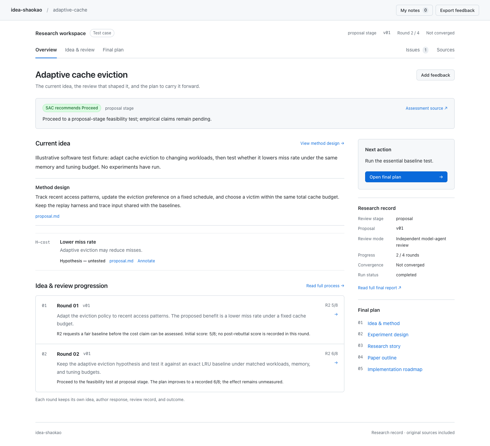
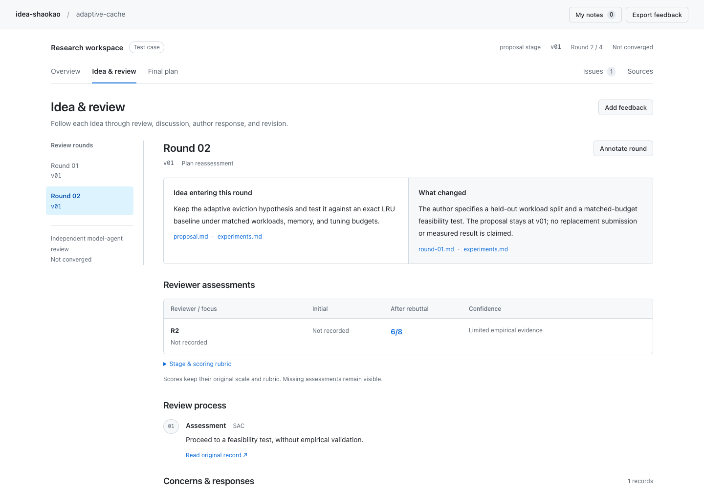
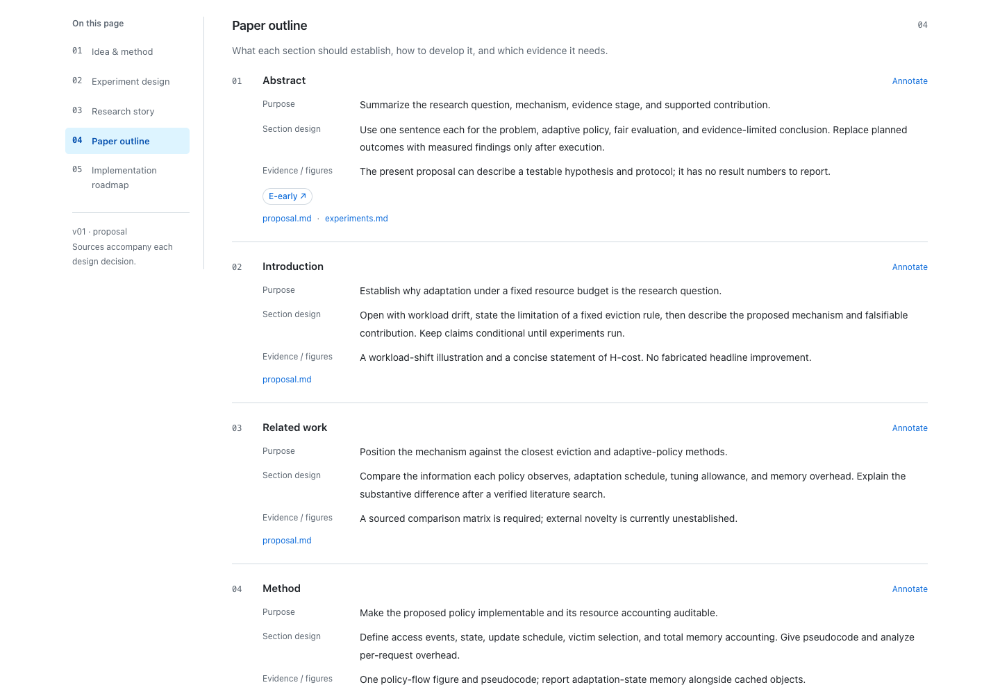

# Review interface examples

The current [research-workspace.html](research-workspace.html) is generated by the
schema-2 engine using explicitly synthetic agent responses and cached official ICML
2026 form instructions. It demonstrates Overview, Final Paper, Experiment Plan, Related Papers and Review Process;
its scientific claims and decisions are software fixtures, not real research.
Regenerate with `python3 design-demos/src/build_workspace_demo.py`.

The remaining HTML files and screenshots below are archived design explorations
from the earlier interface. They do not represent the current engine contract.

# Research workspace

**[Open the current interface example](research-workspace.html)**

The interface is organized around the research rather than an issue tracker:
**Overview → Idea & review → Final plan**. Issues and original sources remain
available as supporting views. It uses native system fonts, white and gray
surfaces, thin borders, a blue interaction color, and small status labels.
There are no display fonts, decorative statistics, external fonts, or animations.



## Reading flow

- **Overview:** current idea, method, claim/evidence states, round progression,
  recommendation, and exact next action.
- **Idea & review:** choose a round; read the submitted idea and actual changes,
  reviewer assessments, full recorded process, concerns/responses, and outcome.
  Historical versions are explicit; a new round does not imply a new proposal.
- **Final plan:** a readable document with a local directory for the method,
  experiment specifications, research story, paper design, and roadmap.
- **Experiment specifications:** hypothesis, setup, data/workloads, baselines,
  metrics, controls/ablations, success/stop criteria, resources, and observed
  evidence. Planned work remains separate from measured results.
- **Paper outline:** each section has a purpose, concrete content design, and
  required evidence/figures. Experiment references jump to the corresponding
  specification.
- **Issues and Sources:** full discussion threads and exact original source text
  with SHA-256 hashes. Sources remain attached to the relevant decisions.



Rounds, experiments, and individual method/story/paper/roadmap blocks support
annotations. Notes and unfinished drafts survive regeneration; Markdown export
and JSON backup/restore preserve original context. Local-storage restrictions
produce an explicit session-only indicator.



## Example data and production rendering

The current example uses **explicitly synthetic software-test artifacts** to show
a two-round proposal and a complete writing plan. Its scores and settings are
illustrations, not real research findings. No experiment is represented as run.
Build it from the production renderer and sourced fixtures:

```bash
python3 design-demos/src/build_workspace_demo.py
```

Actual runs use their own `final/review-data.json` and original artifacts:

```bash
python3 scripts/render_review.py <research-workspace>
```

The production renderer never imports the synthetic fixture. Existing indices
remain compatible and expose missing round snapshots, experiment settings, or
paper designs explicitly. The schema and generation instructions are in
[review-report.md](../references/review-report.md).

## Validation

The integration check exercises all routes at 1440, 1024, 768, and 390 pixels,
round snapshots, scoring/missing-data states, experiment settings, paper links,
source fidelity, original issue-ID search, annotations, draft recovery, changed
sources, removed targets, feedback export, portable backups, and denied storage.
It checks for page overflow, JavaScript errors, and HTTP(S) requests.

```bash
python3 -m unittest discover -s tests -v
node tests/verify_review_browser.cjs
```

`PLAYWRIGHT_MODULE` and `CHROMIUM_EXECUTABLE` can point to an external Playwright
installation and existing Chromium binary. These are development-only tools.
The generated report is a single offline HTML file with no server or build step.

## Earlier explorations

The previous [GitHub Issues layout](github-review.html), [Signal Desk](signal-desk.html),
[Editorial Dossier](editorial-dossier.html), and [Evidence Table](evidence-table.html)
are retained as historical explorations. Their templates and original verification
records are preserved. They are superseded by the research-workspace interface.
