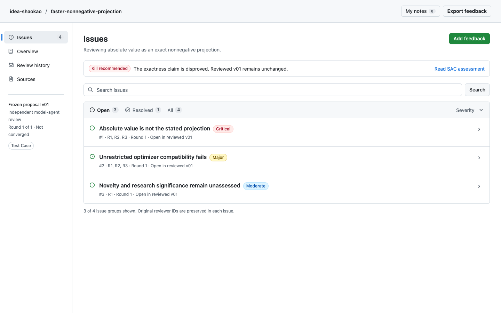
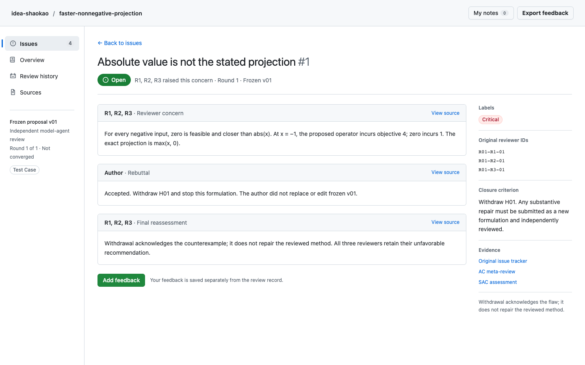

# Research Review — GitHub Issues direction

**[Open the current prototype](github-review.html)** — a single offline HTML file.



The current interface follows the GitHub Issues page supplied by the user:
https://github.com/addyosmani/agent-skills/issues. It uses a white background,
native system fonts, compact rows, gray borders, state filters, and sequential
comment threads. The previous Huashu-based exploration has been superseded.

## Review flow

- **Issues:** search titles, concerns, or original reviewer IDs. Filter by Open,
  Resolved, All, or severity. Three duplicate correctness concerns form one group.
- **Issue detail:** read the reviewer concern, author rebuttal, and final
  reassessment in order. Original IDs and closure criteria sit beside the thread.
- **Overview:** inspect the idea, recommendation, claims, and experiment status.
- **Review history:** inspect actual scores and the complete one-round sequence.
- **Sources:** open any of the 18 exact bundled original documents and its hash.
- **Feedback:** add a question, evidence request, or suggestion to a claim, issue,
  or section. Edit/delete it under My notes and download `review_feedback.md`.



Search and filters survive navigation and reload in the same tab when session
storage is available. Notes and unfinished comments use local browser storage.
The HTML itself is not rewritten: export feedback to share or retain your notes
when moving the file. If local storage is blocked, a visible session-only message
appears and annotation/export continue to work.

Everything opens without a server or network. The current prototype uses native
UI fonts, with source data and scripts embedded in the HTML. Human feedback is
separate from the scientific record.

## Evidence and verification

All content comes from the actual projection-review test case. The Kill verdict,
unknown novelty/runtime, unchanged frozen v01, open technical defects, and canceled
E02/E03 checks are preserved. No research results or reviewer scores were invented.

The prototype passed at 1440×900 and 1024×768, including issue routing, filters,
search/empty states, source fidelity, all reading sections, annotation editing and
deletion, saved notes/draft recovery, safe verbatim text, Markdown export, and
storage-denied fallback. No console errors or HTTP(S) requests were recorded.
See [interaction results](verification/github-review-results.json) and
[readability results](verification/readability-results.json).

Rebuild with Python 3.10+ and the standard library:

```bash
python3 design-demos/src/build_demos.py
```

Run browser checks with Playwright available to Node:

```bash
node design-demos/src/verify_github_review.cjs
node design-demos/src/check_readability.cjs github-review
```

`PLAYWRIGHT_MODULE` can point to an external Playwright installation and
`CHROMIUM_EXECUTABLE` to an existing Chromium binary. These are development-only
requirements; the HTML file has none.

## Earlier explorations

The earlier prototypes are retained for comparison and history:
[Signal Desk](signal-desk.html), [Editorial Dossier](editorial-dossier.html), and
[Evidence Table](evidence-table.html). Their templates, embedded font licenses,
and verification records are unchanged. The build helper regenerates all four
prototypes; `verify_demos.cjs` checks the earlier three.

The current delivery is the revised review interface. Generating it automatically
as `final/review.html` remains a subsequent skill integration task.
